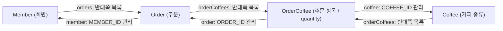

# Spring Data JPA: 코드와 SQL을 따라 하며 복습하기

이 저장소는 [Spring Data JPA 학습자료](https://calm-individual-12a.notion.site/Spring-Data-JPA-41bc6b709828800aa8f1dc7adc3767c0)를 공부하며 작성한 예제다. 복습 범위는 **ORM/JPA → 영속성 컨텍스트 → 엔티티 설계 → 연관관계와 Discodeit 매핑 → Repository → Page/Slice → ID 커서 조회 → N+1과 fetch join/EntityGraph → cascade와 고아 객체 제거**다.

목표는 애너테이션을 외우는 데서 끝나지 않고, “지금 어떤 객체가 관리되는가?”, “어떤 필드가 외래 키를 결정하는가?”, “어느 시점에 어떤 SQL이 실행되는가?”를 코드와 DB 결과로 설명하는 것이다. 기존 4장까지의 기초 실습을 유지하고, 새로 학습한 교안 5~7장의 내용과 Discodeit 적용 예제를 그 뒤에 이어서 읽는다.

## 1. 처음 실행하기

### 준비와 실행

- 소스 컴파일용 JDK 17이 필요하다. 이 저장소는 Java 17 toolchain을 지정한다. 검증 환경에서는 Gradle 실행에 JDK 21, 소스 컴파일과 예제 실행에 JDK 17을 사용했다.
- 프로젝트에 포함된 Gradle Wrapper를 사용한다. 첫 실행에는 Gradle과 의존성을 내려받을 인터넷 연결이 필요하다.
- 저장소의 기본 프로필 `dev`는 기존 수업용 PostgreSQL을 사용한다. **이 문서의 명령은 `--spring.profiles.active=local`로 H2 메모리 DB를 선택**하므로 PostgreSQL 설치 없이 따라 할 수 있다.
- IntelliJ에서 열었다면 Gradle 프로젝트를 불러오고 Lombok 애너테이션 처리가 활성화되어 있는지 확인한다.

프로젝트 최상위 디렉터리에서 실행한다. 첫 실습은 다음 명령으로 시작한다.

```bash
./gradlew bootRun --args='--spring.profiles.active=local --study.lesson=basic --study.example=01'
```

Windows에서는 같은 명령의 `./gradlew`를 `gradlew.bat`로 바꾼다. 터미널에서 실행 권한 오류가 나면 macOS/Linux에서 `chmod +x gradlew` 후 다시 실행한다.

콘솔에서 `[basic]`, `[01]` 표시와 SQL 로그를 확인한다. 웹 서버가 함께 실행되므로 예제 출력이 끝나도 프로세스는 대기한다. **다음 예제를 실행하기 전에 Ctrl+C로 종료**한다. 서버 없이 콘솔 실습만 실행하고 바로 종료하려면 다음 인자를 추가한다.

```bash
./gradlew bootRun --args='--spring.profiles.active=local --study.lesson=basic --study.example=01 --spring.main.web-application-type=none'
```

기본 `study.lesson`은 `api`다. 아래 명령은 H2에서 회원 API 서버를 시작하고 목록 실습용 회원 10명·주문 5건·회원 상태 10건을 준비한다. API 실습을 할 때는 서버를 계속 켜 두고 다른 터미널에서 `curl` 요청을 보낸다.

```bash
./gradlew bootRun --args='--spring.profiles.active=local'
```

기초 Runner는 `basic=01`, `mapping=identity`, `relations=many-to-many`, `discodeit=mapping`을 각 기본 예제로 사용한다. 아래 표에서 단원을 선택하자. 각 Runner 실습에서는 API 초기 데이터를 넣지 않으므로 예제가 직접 만든 행만 관찰할 수 있다.

| 학습 목적 | `study.lesson` | `study.example` |
| --- | --- | --- |
| 영속성 컨텍스트 | `basic` | `01`~`06` |
| 식별자와 컬럼 | `mapping` | `identity`, `column`, `transient`, `updatable`, `unique`, `nullable` |
| 회원·주문·커피 관계 | `relations` | `enum`, `many-to-one`, `one-to-many`, `owner`, `many-to-many` |
| Discodeit 관계 | `discodeit` | `mapping`, `one-to-one` |
| Repository와 HTTP API | `api` | 사용하지 않음 |
| 시작 데이터·Runner 없이 자동 검증 | `none` | 사용하지 않음 |

인자 없는 `./gradlew bootRun`은 PostgreSQL 연결을 시도한다. H2로 복습할 때는 위 프로필 인자를 빼지 않는다.

### 실행할 때 내부에서 일어나는 순서

1. `CodeitSpringJpaExampleApplication.main()`이 스프링을 시작한다.
2. `application.yml`과 선택한 프로필 설정을 읽고, DB 연결과 엔티티 매핑을 준비한다.
3. `study.lesson`에 해당하는 Runner를 활성화한다. `api`에서는 초기 데이터 Runner만 실행하고 HTTP 요청을 기다린다.
4. `basic`/`mapping`/`relations`/`discodeit`에서는 `study.example`에 해당하는 메서드 하나를 실행한다.
5. 직접 EntityManager를 사용하는 예제는 생성 → 트랜잭션 시작 → 저장/조회/수정 → 커밋 → 필요시 clear와 재조회 → 닫기 순으로 진행한다. 실패하면 남아 있는 트랜잭션을 롤백한다. API에서는 Service의 `@Transactional` 범위에서 같은 저장·변경 원리를 확인한다.

`study.lesson`과 `study.example`은 실행할 학습 코드를 고르는 설정값이다. JPA 매핑 문법은 아니므로 처음에는 Runner의 선택 부분을 그대로 두고 실제 예제 메서드에 집중하면 된다. 애너테이션 주석을 해제하거나 여러 Runner를 동시에 켤 필요가 없다.

### DB에서 직접 확인하기

일반 웹 실행 상태에서 [H2 콘솔](http://localhost:8080/h2)에 접속한다.

| 항목 | 값 |
| --- | --- |
| JDBC URL | `jdbc:h2:mem:test` |
| User Name | `sa` |
| Password | 빈칸 |

콘솔의 URL을 기본 표시값 대신 위 값으로 맞춘다. `MEMBER`는 기초 예제, `MEMBERS`는 엔티티 설계·주문 예제의 회원 테이블이다. 기본 매핑에서는 `ORDERS`, `COFFEE`, `ORDER_COFFEE`도 생성된다. 기본/컬럼 예제만 실행해도 사용하지 않은 엔티티의 빈 테이블이 보이는 것은 정상이다.

```sql
SELECT * FROM MEMBER;
SELECT * FROM MEMBERS;
SELECT * FROM ORDERS;
SELECT * FROM COFFEE;
SELECT * FROM ORDER_COFFEE;
```

`ddl-auto: create`는 시작할 때 기존 테이블을 다시 만든다. H2는 종료할 때 데이터도 사라지므로 **Runner 예제 하나를 실행하고 관찰한 뒤 종료하는 방식**으로 진행한다. API의 POST/PATCH/DELETE로 데이터를 바꾼 뒤 처음의 예상 결과를 다시 보고 싶으면 서버를 종료하고 재시작한다. `application-dev.yml`의 PostgreSQL도 `create` 설정이므로 기존 데이터가 있는 DB에 연결하지 말고 별도의 학습용 DB를 사용한다.

`MemberDataRunner`는 `api` 단원에서만 실행되며 이미 회원이 있으면 초기 데이터를 다시 넣지 않는다. `data.sql`은 기존 PostgreSQL 전용 문법을 포함한 수업 참고 파일이다. 기본 `spring.sql.init.mode=never`에서는 자동 실행하지 않고, 초기 데이터는 Runner에서 JPA로 저장한다. 따라서 H2에서 이 SQL 파일을 직접 실행할 필요가 없다.

## 2. 파일을 읽는 순서

아래 경로는 `src/main/java/com/codeit/codeitspringjpaexample/` 아래를 기준으로 한다. 같은 이름의 `Member`가 두 개 있으므로 import까지 확인한다.

| 순서 | 파일 | 먼저 찾을 부분 |
| --- | --- | --- |
| 0 | `CodeitSpringJpaExampleApplication.java` | `main`과 시작 과정 |
| 1 | `basic/entity/Member.java` | 가장 작은 엔티티, ID, email |
| 2 | `basic/JpaBasicConfig.java` | `example01`부터 `example06`까지 |
| 3 | `member/entity/Member.java` | 컬럼, IDENTITY, `@Transient`; 관계 목록은 잠시 뒤에 읽기 |
| 4 | `member/direct/JpaIdMappingConfig.java` | 식별자와 컬럼별 실험 |
| 5 | `coffee/entity/Coffee.java`, `order/entity/Order.java` | 엔티티 필드와 enum; 관계 필드는 4단계에서 다시 읽기 |
| 6 | `Order.member` → `Member.orders` | 주인과 반대쪽 탐색 |
| 7 | `order/entity/OrderCoffee.java` → `Order.orderCoffees` → `Coffee.orderCoffees` | 두 외래 키, 수량, 양방향 연결 |
| 8 | `order/test/OrderTestRunner.java` | enum부터 다대다까지 실행 흐름 |
| 9 | `discodedit/entity/User.java`, `Channel.java`, `ReadStatus.java`, `UserStatus.java` | 다른 도메인에서 같은 FK 매핑을 설명하기 |
| 10 | `discodedit/DiscodeitMappingRunner.java` | 다대다를 중간 엔티티로 풀고 일대일을 저장·재조회하기 |
| 11 | `member/controller/MemberController.java` → `member/service/MemberService.java` → `member/repository/MemberRepository.java` | API 요청 하나를 끝까지 추적하기 |
| 12 | `member/dto/MemberDto.java`, `member/mapper/MemberMapper.java` | 요청 DTO → 엔티티 → 응답 DTO |
| 13 | `global/dto/PageResponseDto.java`, `SliceResponseDto.java`, `CursorResponseDto.java`, `PageInfo.java` | 조회 결과에 어떤 정보를 붙이는지 비교하기 |
| 14 | `member/entity/MemberStatus.java` → `Member.memberStatus`, `Member.orders`, `Order.orderCoffees` | 저장·삭제 전파와 고아 객체 제거 |
| 15 | `member/direct/MemberDataRunner.java` | API 초기 데이터를 어떤 순서로 저장하는지 확인하기 |

현재 Controller·Service·Repository는 실제로 실행되는 코드다. 이전 가이드의 비활성 웹 예제를 확장한 것으로, 이제 HTTP 요청으로 저장과 목록 조회를 관찰한다. `discodedit`은 기존 소스의 패키지 철자를 유지한 경로이며, 문서에서 부르는 학습 도메인은 Discodeit이다.

엔티티는 전체 진도를 반영한 최종 상태다. 처음 기초 부분을 읽을 때는 `memberStatus`, `cascade`, `orphanRemoval` 설명을 뒤의 단계 10에서 다시 확인하면 된다. 파일에서 보이는 모든 애너테이션을 첫 단계에 한꺼번에 학습할 필요는 없다.

## 3. 단계 1 — ORM과 영속성 컨텍스트

### 먼저 이해할 개념

- **ORM**: 자바 객체와 관계형 DB의 테이블을 매핑해 객체의 저장·조회를 SQL과 연결하는 방식이다.
- **JPA**: ORM을 사용하기 위한 자바 표준 API다. 이 프로젝트에서는 Hibernate가 실제 매핑과 SQL 처리를 수행한다.
- **EntityManagerFactory**: EntityManager를 만드는 출발점이다. 스프링이 준비한 Factory를 주입받아 사용한다.
- **EntityManager / 영속성 컨텍스트**: 엔티티를 관리하고 식별자에 따라 조회하며 변경을 추적한다. 1차 캐시는 이 관리 범위에 속한다.
- **트랜잭션**: 변경을 확정하거나 취소하는 단위다. `persist`와 `commit`은 별개의 동작이다.

### 따라 작성하는 순서

1. `basic/entity/Member`에서 `@Entity`, `@Id`, `@GeneratedValue`, `email`, 기본 생성자를 살펴본다. `new Member(...)`가 DB 저장 명령은 아니라는 점을 먼저 설명해 본다.
2. `JpaBasicConfig`에서 `example01()`의 본문을 기준으로 `tx.begin()` → 객체 생성 → `persist()` → `find()` → `commit()` 순서로 따라 작성한다.
3. 실행 전에 출력값과 SQL이 나올 위치를 예상한다. 실행 후 예상과 비교한다.
4. 아래 표 순서로 `study.example`만 바꿔 각각 다시 실행한다. 앞 예제의 데이터가 남아 있어야 하는 구조가 아니며 각 예제가 자기 데이터를 준비한다.

| 예제 | 관찰할 동작 | 기대 결과 / 확인할 SQL |
| --- | --- | --- |
| `01` | 비영속 → 영속, 1차 캐시 | 관리 여부 `false → true`, `member == found`는 `true` |
| `02` | commit 후 clear, DB 조회 후 캐시 조회 | 두 find는 같은 객체, clear 이전 객체와는 다른 객체; 첫 find의 SELECT 확인 |
| `03` | 두 객체 persist → flush → commit | INSERT 위치 비교; flush 후에도 트랜잭션 활성 상태 `true` |
| `04` | 조회한 객체의 email 변경 | 별도 update 호출 없이 UPDATE, DB 재조회는 `vanilla@cat.cat` |
| `05` | 조회한 객체 remove | DELETE, clear 후 find 결과 `null` |
| `06` | clear로 준영속 상태가 된 객체 수정 | 관리 여부 `false`, 객체는 `detached@cat.cat`, DB는 `original@cat.cat` |

예를 들어 변경 감지는 다음 명령으로 확인한다.

```bash
./gradlew bootRun --args='--spring.profiles.active=local --study.lesson=basic --study.example=04'
```

`@GeneratedValue`의 기본 전략은 AUTO이며 실제 ID 생성 방식은 구현체와 DB가 결정한다. ID 확보용 SQL이 먼저 보일 수 있다. 다음 단계의 IDENTITY에서는 ID를 받으려고 `persist` 시 INSERT가 실행될 수도 있다. **“persist는 항상 SQL을 실행하지 않는다”라고 일반화하지 않는다.**

`flush()`는 관리 중인 변경을 DB에 동기화하는 동작이고 `commit()`은 트랜잭션을 확정하는 동작이다. `clear()`는 객체를 관리 대상에서 분리하며 DB 데이터를 지우지 않는다. commit도 그 자체로 모든 객체를 준영속 상태로 바꾸는 명령은 아니다.

### 스스로 설명해 보기

- 같은 ID를 두 번 `find`했을 때 같은 객체가 반환되는 조건은 무엇인가?
- SQL 로그에 INSERT가 나왔다는 사실만으로 트랜잭션이 커밋됐다고 할 수 있는가?
- `clear` 뒤 객체의 email만 수정했을 때 DB가 바뀌지 않는 이유는 무엇인가?

## 4. 단계 2 — 엔티티와 컬럼 설계

이번에는 **`member/entity/Member`**를 사용한다. 기초용 `basic/entity/Member`와 섞지 않는다.

### 따라 작성하는 순서

1. `memberId`와 `@GeneratedValue(strategy = IDENTITY)`를 확인한다. ID는 생성자에 직접 넣지 않는다.
2. `email`, `name`, `phone`의 `@Column` 설정을 읽고 정상 저장에 필요한 값을 만든다. `new Member()`만 영속화하면 필수값이 빠진다.
3. 생성자에서 email/name/phone을 초기화하고, `JpaIdMappingConfig`의 `identity()`를 따라 쓴다.
4. 아래 표 순서로 필드 하나씩 관찰한다. 예제마다 commit 후 clear와 재조회를 하는 이유도 확인한다.
5. `Coffee`의 가격/이름/코드와 `Order`의 날짜/상태 필드를 같은 방식으로 읽는다.

| 예제 | 설정의 의미 | 기대 결과 |
| --- | --- | --- |
| `identity` | DB가 기본 키 생성 | persist 전 ID `null`, 저장 후 생성된 ID로 재조회 |
| `column` | 일반 컬럼과 변경 감지 | name을 바꾸면 DB 재조회 결과 `변경 후` |
| `transient` | `@Transient` 필드는 저장 제외 | 같은 객체의 age는 `20`, clear 후 재조회 객체의 age는 `null` |
| `updatable` | email을 UPDATE 대상에서 제외 | 객체 email은 `changed@cat.cat`, DB email은 `original@cat.cat`; name은 변경됨 |
| `unique` | 이메일 중복 금지 | 의도한 제약 위반 로그와 `[unique] 예상한 제약 위반` 표시 |
| `nullable` | name의 null 금지 | 의도한 제약 위반 로그와 `[nullable] 예상한 제약 위반` 표시 |

```bash
./gradlew bootRun --args='--spring.profiles.active=local --study.lesson=mapping --study.example=identity'
./gradlew bootRun --args='--spring.profiles.active=local --study.lesson=mapping --study.example=updatable'
```

위 명령은 각각 따로 실행한다. `unique`, `nullable`은 **실패 원인을 관찰하는 예제**다. 예상된 저장 예외를 처리한 다음 롤백하므로 이 실습의 행은 남지 않는다. 오류가 persist 시점에 나타날 수도 있고 flush 시점에 나타날 수도 있다. 마지막의 예상 제약 위반 표시와 그 위의 실제 원인을 함께 읽는다.

주의해서 구분할 내용은 다음과 같다.

- `@Entity(name = "MEMBERS")`는 JPA 엔티티 이름을 지정한다. DB 테이블 이름을 별도로 지정하는 애너테이션은 `@Table`이다. 현재는 별도 테이블명을 지정하지 않아 기본 매핑으로 `MEMBERS`를 사용한다.
- `nullable`, `unique`, `length`는 컬럼 매핑 정보다. setter 호출 시 입력을 검사해 주는 기능이 아니다. `length`는 문자열 컬럼 길이를 정하며 숫자 필드의 값 범위를 정하지 않는다.
- `updatable=false`는 setter를 막지 않는다. 객체 값과 DB 값이 다를 수 있으므로 clear 후 재조회로 비교한다.
- `@Transient`와 자바의 `transient` 키워드를 혼동하지 않는다. 여기서는 JPA 매핑 제외를 관찰한다.
- `createdAt`, `modifiedAt`은 현재 객체 생성 시 초기값만 들어간다. 수정 시간을 자동으로 바꾸는 기능은 없으며 `column` 예제에서는 직접 수정한다.
- Lombok의 `@Getter`, `@Setter`, `@NoArgsConstructor`는 자바 메서드/생성자를 만드는 도구다. DB 매핑을 지정하지 않는다.

`OrderStatus`의 enum은 다음 단계 첫 예제에서 관찰한다. `EnumType.STRING`은 `ORDER_REQUEST` 같은 **상수 이름**을 저장한다. `stepNumber`나 한국어 설명을 저장하는 설정이 아니다.

## 5. 단계 3 — 단방향에서 양방향으로

### 테이블과 객체 관계를 먼저 그리기

테이블은 외래 키로 연결되고, 객체는 필드의 참조로 연결된다. 객체에서 어느 쪽으로 탐색할 것인지와 외래 키를 어느 쪽이 쓰는지를 구별한다.



| 관계 | 외래 키가 있는 테이블 | 주인 필드 | 반대쪽 필드와 mappedBy |
| --- | --- | --- | --- |
| 회원 1 : 주문 N | `ORDERS.MEMBER_ID` | `Order.member` | `Member.orders`, `mappedBy="member"` |
| 주문 1 : 주문 항목 N | `ORDER_COFFEE.ORDER_ID` | `OrderCoffee.order` | `Order.orderCoffees`, `mappedBy="order"` |
| 커피 1 : 주문 항목 N | `ORDER_COFFEE.COFFEE_ID` | `OrderCoffee.coffee` | `Coffee.orderCoffees`, `mappedBy="coffee"` |

`mappedBy`에는 DB 컬럼명이나 클래스명이 아닌 **상대 엔티티의 자바 필드명**을 쓴다. 이 목록에만 객체를 추가해서는 외래 키가 갱신되지 않는다. “연관관계의 주인”은 외래 키를 관리하는 필드를 뜻하며, 업무에서 더 중요한 객체라는 뜻이 아니다.

### 따라 작성하는 순서

1. `Order`의 `member` 필드에 `@ManyToOne`, `@JoinColumn(name="MEMBER_ID")`가 있는 이유를 읽는다. 이것이 주문 → 회원 단방향 매핑의 핵심이다.
2. 회원을 먼저 persist하고, 주문의 `member`를 설정한 다음 주문을 persist하는 흐름을 따라 쓴다.
3. 반대쪽 탐색이 필요할 때 `Member.orders`와 `@OneToMany(mappedBy="member")`를 추가하는 순서를 이해한다. 현재 저장소는 여기까지 완성된 상태다.
4. `member.addOrder(order)`와 `order.addMember(member)`가 두 객체의 참조를 어떻게 맞추는지 한 줄씩 추적한다. 서로 부르더라도 조건 검사로 재호출이 멈추는 지점을 찾는다.
5. 마지막으로 `owner` 예제에서 반대쪽만 변경했을 때와 주인까지 변경했을 때를 비교한다.

```bash
./gradlew bootRun --args='--spring.profiles.active=local --study.lesson=relations --study.example=many-to-one'
```

| 실행 순서 | 예제 | 확인할 결과 |
| --- | --- | --- |
| 1 | `enum` | 재조회 상태 `ORDER_REQUEST`; DB의 `ORDER_STATUS`도 상수 이름 |
| 2 | `many-to-one` | setter 직후 회원.orders는 `0`, DB 재조회 주문 → 회원은 `luckyKim`, 재조회 회원.orders는 `1` |
| 3 | `one-to-many` | 편의 메서드로 양쪽 연결; clear 이전과 이후 모두 주문 목록 크기 `1` |
| 4 | `owner` | 목록만 변경하면 재조회 order.member는 `null`, 회원.orders는 `0`; 편의 메서드로 고친 뒤 회원 이름과 목록 크기 `1` 확인 |

`many-to-one` 예제는 **완성된 양방향 엔티티에서 한 방향만 사용**하는 실습이다. 현재 `Member.orders` 매핑도 있으므로 구조 자체가 단방향인 것은 아니다. 단방향부터 새로 따라 작성할 때는 주문의 member 참조까지만 만든 뒤 반대쪽 목록과 편의 메서드를 추가하는 순서로 진행한다. 이 저장소에서 실행만 복습할 때는 관계 필드를 지울 필요가 없다.

일반 setter는 반대쪽 목록까지 자동으로 맞추지 않는다. 편의 메서드는 객체 양쪽의 상태를 맞추지만, **그 자체로 persist나 commit을 실행하지 않는다.** 이 둘을 구분해야 “메모리에서는 보이는데 DB에는 안 남는” 상황을 설명할 수 있다.

## 6. 단계 4 — 다대다 관계를 중간 엔티티로 풀기

한 주문에는 여러 커피가 들어가고 같은 커피는 여러 주문에 들어갈 수 있다. 이 연결에는 주문별 수량도 필요하다. 현재 예제는 교안처럼 `OrderCoffee`를 두어 두 개의 다대일 관계로 표현한다.

```text
Order 1 ── N OrderCoffee N ── 1 Coffee
               quantity
```

여기서 양방향은 `Order ↔ OrderCoffee`와 `Coffee ↔ OrderCoffee` 양쪽에서 탐색할 수 있다는 뜻이다. `@ManyToMany`로 두 엔티티를 직접 연결하는 예제는 추가하지 않는다.

### 따라 작성하는 순서

1. `OrderCoffee`의 자체 식별자와 `order`, `coffee`, `quantity` 필드를 읽는다. 수량이 Coffee가 아닌 주문 항목에 있어야 하는 이유를 생각한다.
2. `order`, `coffee`에 각각 `@ManyToOne`과 `@JoinColumn`으로 외래 키를 매핑한다.
3. `Order.orderCoffees`와 `Coffee.orderCoffees`에 역방향 목록과 정확한 `mappedBy` 필드명을 지정한다.
4. `addOrder`/`addCoffee`로 양쪽 참조를 맞춘다. 같은 항목이 중복으로 들어가지 않는 조건도 확인한다.
5. Runner의 `mappingManyToManyTest()`를 다음 순서로 따라 작성한다: 회원·커피 두 종류 저장 → 주문과 회원 연결·주문 저장 → 주문 항목 두 개 생성 → 주문·커피 연결·수량 설정 → 항목 각각 저장 → commit → clear → 재조회.

```bash
./gradlew bootRun --args='--spring.profiles.active=local --study.lesson=relations --study.example=many-to-many'
```

확인할 결과는 다음과 같다. ID의 구체적인 숫자와 목록의 출력 순서는 고정하지 않는다.

```text
[다대다] 주문한 회원 = luckyKim
[다대다] 주문항목 개수 = 2
[다대다] 아메리카노 / 2잔
[다대다] 카페 라테 / 1잔
[다대다] 아메리카노 → 주문항목 개수 = 1
[다대다] 커피 → 주문항목 → 주문 ID = (생성된 주문 ID)
```

DB에서는 `ORDER_COFFEE`의 두 행에 `ORDER_ID`, `COFFEE_ID`, `QUANTITY`가 올바르게 들어갔는지 확인한다. 부모 객체를 참조하는 것만으로 저장이 끝나는 것이 아니므로, 이 실습에서는 참조할 엔티티를 먼저 저장하고 주문 항목도 각각 명시적으로 persist한다.

### 같은 범위에서 해 보는 복습 과제

- 같은 아메리카노를 3잔 담은 두 번째 주문과 주문 항목을 추가한다. 기존 커피 객체를 재사용하고, commit → clear 후 아메리카노의 주문 항목 수가 `2`인지 확인한다. 이것이 “여러 주문이 같은 커피를 참조함”을 보여 준다.
- 기존 주문 항목의 수량을 바꾸고 commit → clear 후 변경 감지로 반영됐는지 확인한다.
- 같은 `addOrderCoffee`를 두 번 호출한 뒤 목록에 항목이 한 번만 들어 있는지 확인한다.
- `order.member`와 `member.orders`를 각각 출력해 편의 메서드가 양쪽을 연결했는지 확인한다. 현재 최종 매핑에는 고아 객체 제거가 있으므로, 저장된 주문을 기존 회원 목록에서 빼서 다른 회원에게 옮기는 실험은 단계 10의 삭제 의미를 먼저 읽는다.

## 7. 단계 5 — Discodeit에 같은 매핑 적용하기

회원·주문 예제를 이해한 뒤 도메인 이름이 바뀌어도 매핑을 설명할 수 있는지 확인한다. 이 실습은 기존 `discodedit` 패키지의 `User`, `Channel`, `ReadStatus`, `UserStatus`를 사용한다.

```text
User 1 ── N ReadStatus N ── 1 Channel
User 1 ── 1 UserStatus
```

`ReadStatus`는 “어떤 사용자가 어떤 채널을 읽는가”를 연결한다. `UserStatus`는 특정 사용자의 상태 하나를 연결한다. 이름이 비슷해도 서로 다른 관계를 나타내므로 FK를 각각 찾아보자.

| 엔티티 필드 | 자기 테이블의 FK | 참조 대상 기본 키 | 반대쪽 |
| --- | --- | --- | --- |
| `ReadStatus.user` | `READ_STATUS.USER_ID` | `USERS.USER_ID` | `User.readStatuses`, `mappedBy="user"` |
| `ReadStatus.channel` | `READ_STATUS.CHANNEL_ID` | `CHANNEL.CHANNEL_ID` | `Channel.readStatuses`, `mappedBy="channel"` |
| `UserStatus.user` | `USER_STATUS.USER_ID` | `USERS.USER_ID` | `User.userStatus`, `mappedBy="user"` |

`@JoinColumn(name="user_id")`의 name은 **이 필드를 가진 엔티티 테이블의 FK 컬럼명**이다. 참조 대상은 필드의 자바 타입 `User`와 그 엔티티의 `@Id`로 연결된다. `mappedBy="user"`도 이 컬럼명이 아니라 상대편 자바 필드명을 가리킨다.

### 따라 작성하는 순서

1. `User`와 `Channel`의 식별자·기본 필드를 읽는다.
2. `ReadStatus`에서 `user`, `channel`의 두 `@ManyToOne` 필드를 먼저 작성한다.
3. `User.readStatuses`, `Channel.readStatuses`에 역방향 목록과 `mappedBy`를 추가한다.
4. `addReadStatus`, `setUser`, `setChannel`이 중복 없이 양쪽을 연결하는지 추적한다. 기존 이름 `setReadStatuses`는 같은 연결을 위한 호환 메서드다.
5. `DiscodeitMappingRunner`의 `mapping` 예제를 따라 사용자 → 채널 → 연결 엔티티 순서로 각각 persist한다. 여기에는 cascade를 붙이지 않아 저장 대상을 직접 볼 수 있다.

```bash
./gradlew bootRun --args='--spring.profiles.active=local --study.lesson=discodeit --study.example=mapping'
```

저장할 데이터는 사용자 `봄`·`여름`, 채널 `java`·`spring`, 연결 세 개다. commit → clear 후 **봄의 채널 2개, 여름의 채널 1개, java 사용자 2명, spring 사용자 1명**을 확인한다. 사용자와 채널의 다대다 관계를 중간 엔티티의 두 FK로 표현했다는 점을 커피 예제와 연결한다.

### 일대일 관계 이어서 확인하기

`UserStatus.user`에 `@OneToOne`, `@JoinColumn`이 있고 `User.userStatus`에는 `mappedBy="user"`가 있다. 일대일에서도 FK를 가진 쪽이 주인이라는 원리는 같다. 다대일과 달리 한 사용자에 여러 상태 행이 붙지 않도록 일대일 제약을 매핑한다.

```bash
./gradlew bootRun --args='--spring.profiles.active=local --study.lesson=discodeit --study.example=one-to-one'
```

사용자와 상태를 각각 저장한 뒤 양쪽 탐색을 확인하고, `setUser(null)`로 연결을 해제한 결과를 다시 조회한다. 이 관계에는 `orphanRemoval`이 없으므로 **FK를 null로 만드는 것과 상태 행을 삭제하는 것은 다르다.** 뒤의 회원·주문 고아 객체 제거와 비교할 기준이다.

## 8. 단계 6 — EntityManager에서 Repository로

이제 같은 저장·조회 작업을 HTTP 요청에서 실행한다. 기초 실습에서 직접 호출하던 `persist`·`find`·`remove`와 영속성 컨텍스트 원리가 사라지는 것이 아니라, Spring Data JPA의 Repository가 반복되는 데이터 접근 코드를 제공한다.

### 요청 한 번을 끝까지 따라가기

```text
HTTP 요청
  → MemberController: 요청값과 DTO 읽기
  → MemberMapper: 요청 DTO를 Member로 변환
  → MemberService: 중복 확인, 관계 연결, 트랜잭션 안에서 저장/조회
  → MemberRepository: JPA 데이터 접근
  → MemberMapper: 응답 DTO로 변환
  → JSON 응답
```

1. `MemberRepository extends JpaRepository<Member, Long>`을 읽는다. 첫 타입은 대상 엔티티, 두 번째 타입은 그 엔티티의 ID 타입이다. 인터페이스 구현 코드를 직접 만들지 않아도 스프링이 데이터 접근 구현을 준비한다.
2. `save`, `saveAndFlush`, `findById`, `findAll`, `delete`가 사용되는 위치를 Service에서 찾는다. 현재 POST는 새 회원을 저장하고 SQL까지 확인하기 위해 `saveAndFlush`를 사용한다. flush는 여전히 commit과 다르다.
3. `MemberDto.POST`의 email/name/phone → Mapper → `Member` 생성 → `createMember` 순서로 따라 작성한다. `memberId`를 POST 본문에서 직접 지정하지 않는다.
4. `@Transactional` 메서드 안에서 관리되는 엔티티를 변경하고 flush/commit할 때 변경이 반영된다는 점을 기초 예제와 연결한다. HTTP 실습에서 `EntityTransaction.begin()`을 직접 덧붙이지 않는다.
5. 엔티티를 JSON으로 직접 돌려주지 않고 `MemberDto.RESPONSE`로 변환하는 부분을 확인한다. 응답은 ID·이메일·이름·전화번호·생성/수정 시각을 담고 관계 목록을 끝없이 따라가지 않는다.

### 세 가지 조회 작성 방식

| 방식 | 코드에서 읽을 메서드 | 이름의 기준 |
| --- | --- | --- |
| 메서드 이름으로 생성 | `findByEmail`, `findByPhone` | `Member`의 자바 필드명 |
| JPQL `@Query` | `findQueryByUsername` | `MEMBERS`라는 엔티티 이름, `m.name`이라는 필드 |
| Native SQL `@Query` | `findNativeQueryByUsername` | 실제 `members` 테이블과 `name` 컬럼 |

JPQL의 `MEMBERS`는 현재 `@Entity(name="MEMBERS")`에서 정한 이름이다. 자바 클래스명이 `Member`라는 이유만으로 쿼리를 `FROM Member`로 바꾸지 않는다. `:username`은 검색값을 넘기는 매개변수이며 `Member`에 username 필드가 있다는 뜻은 아니다. 메서드 이름으로 생성하는 쿼리는 실제 엔티티 필드명을 써야 하므로 `findByEmail`처럼 이름이 맞아야 한다.

### API 서버와 처음의 데이터 확인하기

이후 6~10단계는 아래 서버 한 개를 켜 두고 진행한다. 각 절의 첫 예상 결과는 **재시작 직후 다른 변경 요청을 보내지 않은 데이터**를 기준으로 한다.

```bash
./gradlew bootRun --args='--spring.profiles.active=local'
```

다른 터미널에서 먼저 회원 목록을 요청한다.

```bash
curl -s 'http://localhost:8080/v11/members?page=1&size=3'
```

회원은 ID 내림차순으로 반환된다. 초기 회원 10명 중 첫 요청은 `10, 9, 8`을 반환하고 `hasNext`가 `true`다. 초기 주문은 1번 회원에게 3건, 2번 회원에게 2건이고 나머지 회원은 주문이 없다. 상태도 회원마다 하나씩 저장된다. 이 분포로 주문 없는 회원이 조회에서 빠지지 않는지, N+1 로그에 회원별 주문 수가 맞는지 확인한다.

새 회원 저장은 뒤의 cascade 실습에서 수행한다. 목록을 먼저 관찰해야 초기 10건 기준의 Page/Slice/커서 예상 결과가 유지된다.

## 9. 단계 7 — Page와 Slice 비교하기

두 방식 모두 여기서는 **ID 내림차순의 offset 조회**를 한다. API의 `page=1`은 첫 페이지이고, Service에서 `page - 1`을 넘겨 `PageRequest.of(0, size)`로 바꾼다. 요청 페이지는 1 이상, size는 1~100이며 기본값은 page 1·size 10이다.

| 비교할 내용 | Page | Slice |
| --- | --- | --- |
| HTTP 경로 | `/v11/members/page` | `/v11/members` |
| Repository 호출 | `findAll(Pageable)` | `findAllByOrderByMemberIdDesc(Pageable)` |
| 응답 정보 | data, 현재 페이지/크기/전체 건수/전체 페이지 수 | data, 다음 묶음 유무 |
| 전체 개수 count | 전체 정보를 위해 필요할 수 있음 | 전체 개수를 세지 않음 |
| 다음 데이터 판단 | 전체 정보와 현재 위치 | size보다 한 건 더 읽어 판단 |

### 따라 작성하는 순서

1. `findMembers`에서 `PageRequest`와 `Sort.by("memberId").descending()`을 읽는다.
2. Controller가 `Page.getContent()`와 전체 정보를 `PageResponseDto`·`PageInfo`로 나누는 부분을 따라 작성한다.
3. 아래 Page 요청을 보내고 목록 조회 SQL과 count SQL을 찾는다.
4. `findMembersToSlice`가 **실제 반환형이 Slice인 Repository 메서드**를 호출하는지 확인하고 같은 조건으로 요청한다.
5. 두 응답에서 회원 ID 목록은 같은지, metadata와 SQL이 어떻게 다른지 비교한다.

```bash
curl -s 'http://localhost:8080/v11/members/page?page=1&size=3'
curl -s 'http://localhost:8080/v11/members?page=1&size=3'
```

초기 데이터에서 Page의 `data`는 ID `10, 9, 8`, `pageInfo`는 다음과 같다.

```json
{"page":1,"size":3,"totalElements":10,"totalPages":4}
```

Slice는 같은 data와 `hasNext:true`를 반환한다. 다음 요청도 비교한다.

```bash
curl -s 'http://localhost:8080/v11/members/page?page=4&size=3'
curl -s 'http://localhost:8080/v11/members?page=4&size=3'
```

두 방식 모두 마지막 ID `1` 하나가 남고 Slice는 `hasNext:false`다. Page의 count는 결과만으로 전체 수를 알 수 있는 경우 생략되기도 하므로 **항상 정확히 SELECT 두 번**이라고 외우지 않는다. 또한 다른 연관관계를 읽는 SQL이 있을 수 있어 전체 SQL 개수와 count 존재 여부를 나누어 관찰한다. [Spring Data의 Page/Slice 설명](https://docs.spring.io/spring-data/jpa/reference/repositories/query-methods-details.html#repositories.special-parameters)

`Slice<Member> result = repository.findAll(pageable)`처럼 **Page를 만드는 메서드의 결과를 Slice 변수에 담는 것만으로 count를 없앨 수는 없다.** 메서드가 실제로 어떤 조회를 실행하는지가 중요하다.

## 10. 단계 8 — 회원 ID로 커서 조회 완성하기

커서는 “다음 페이지 번호”가 아니라 **마지막으로 받은 회원 ID**다. 현재 정렬이 `memberId DESC`이므로 다음 데이터 조건은 `memberId < cursor`다. 이 실습은 단일 Long ID를 기준으로 하는 커서다.

### 따라 작성하는 순서

1. Repository의 `findAllByOrderByMemberIdDesc(Pageable)`와 `findAllByMemberIdLessThanOrderByMemberIdDesc(Long cursor, Pageable)`를 비교한다.
2. `findMembersByCursor`에서 cursor가 없으면 첫 묶음을, 있으면 ID 조건을 넣어 조회하는 흐름을 따라 작성한다.
3. 두 경우 모두 `PageRequest.of(0, size)`를 쓴다는 점을 확인한다. 페이지 번호를 증가시키는 대신 where 조건으로 시작 위치를 바꾼다.
4. Controller에서 Slice의 `hasNext`를 사용한다. 다음 데이터가 있으면 **응답 data의 마지막 회원 ID**를 `nextCursor`로 넣고, 없으면 `null`로 끝낸다.
5. `CursorResponseDto`의 `nextCursor`가 `Long`인 이유를 ID 타입과 종료 시 `null`을 함께 표현한다는 점에서 설명한다.

첫 요청에는 cursor를 넣지 않는다. size 기본값은 10이지만, 흐름을 보려고 3으로 지정한다.

```bash
curl -s 'http://localhost:8080/v11/members/cursor?size=3'
```

응답에서 data의 회원 ID와 다음 값을 확인한다. 표는 초기 10명 기준이며 실제 요청에서는 직전 응답의 `nextCursor`를 그대로 사용한다.

| 요청 | 반환 회원 ID | hasNext | nextCursor |
| --- | --- | --- | --- |
| `?size=3` | `10, 9, 8` | `true` | `8` |
| `?size=3&cursor=8` | `7, 6, 5` | `true` | `5` |
| `?size=3&cursor=5` | `4, 3, 2` | `true` | `2` |
| `?size=3&cursor=2` | `1` | `false` | `null` |

```bash
curl -s 'http://localhost:8080/v11/members/cursor?size=3&cursor=8'
curl -s 'http://localhost:8080/v11/members/cursor?size=3&cursor=5'
curl -s 'http://localhost:8080/v11/members/cursor?size=3&cursor=2'
```

SQL에서 첫 요청에는 ID 경계 조건이 없고 다음 요청에는 ID보다 작은 조건이 생기는지 확인한다. `<=`를 쓰면 직전 마지막 행이 중복될 수 있다. ID는 빈 번호가 있을 수 있으므로 cursor에 페이지 번호를 넣거나 ID에서 1을 빼서 계산하지 않는다. `hasNext:false`면 더 요청하지 않고, `nextCursor:null`을 첫 요청처럼 반복해서 보내지 않는다.

Slice는 “전체 개수 없이 다음 데이터 유무를 담는 반환형”이고, 커서는 “다음 조회의 시작 경계를 정하는 방법”이다. 따라서 offset Slice와 cursor Slice를 함께 사용할 수 있으며, Slice라는 이름만으로 커서 조회가 되는 것은 아니다.

## 11. 단계 9 — N+1을 재현하고 fetch join·EntityGraph 비교하기

이제 관계를 저장하는 방법에서 **조회할 때 관계를 어떤 SQL로 읽는지**로 관심을 옮긴다. 회원 목록을 한 번 읽고 각 회원의 주문을 추가로 조회하면 회원 수에 따라 SQL이 늘어날 수 있다. 목록을 받아 두기만 해서는 지연 로딩이 드러나지 않을 수 있으므로 실습은 실제로 `member.getOrders().size()`를 순회한다.

### 먼저 파일에서 찾을 것

- `Member.orders`의 `@OneToMany`: 기본 지연 로딩으로, 주문 목록을 사용할 때 조회될 수 있다.
- `Member.memberStatus`의 일대일 관계: 이 예제에서는 EAGER 조회도 SQL에 영향을 줄 수 있다.
- `MemberService.findTestMembers(mode)`: 같은 회원 목록에 같은 주문 수 접근을 적용하는 비교 지점이다.
- `MemberRepository.findAllWithOrders()`와 `findAllWithOrdersEntityGraph()`: 조회할 관계를 함께 읽도록 지정하는 두 방식이다.

### 세 요청을 차례로 실행하기

```bash
curl -s 'http://localhost:8080/v11/members/test?mode=basic'
curl -s 'http://localhost:8080/v11/members/test?mode=fetch'
curl -s 'http://localhost:8080/v11/members/test?mode=graph'
```

각 요청마다 서버 콘솔의 `[N+1 시작]`부터 `[N+1 종료]`까지를 읽는다. 반환 JSON은 세 방식 모두 같은 회원 응답 DTO 목록이므로 **응답이 같다는 사실과 SQL 실행 방식이 같다는 사실을 혼동하지 않는다.** 주문 수는 응답에 새 필드로 추가하지 않고 서버 로그로 확인한다.

| mode | 조회 방식 | 로그에서 확인할 점 |
| --- | --- | --- |
| `basic` | 일반 회원 목록 조회 후 주문 수 순회 | 회원별 주문 조회가 추가되는지 확인 |
| `fetch` | JPQL `LEFT JOIN FETCH` | 주문·회원 상태를 함께 읽는 JOIN 확인 |
| `graph` | `@EntityGraph(attributePaths={"orders","memberStatus"})` | 같은 관계들을 함께 읽고 추가 조회가 줄어드는지 확인 |

초기 데이터에서는 모든 방식이 회원 10명을 포함하고, 1번의 주문 수는 3, 2번은 2, 나머지는 0이다. fetch join을 단순 `JOIN`으로 만들면 주문 없는 회원이 결과에서 빠질 수 있으므로 **LEFT JOIN**으로 같은 회원 집합을 유지한다. 컬렉션 JOIN으로 SQL 행이 늘어날 수 있다는 점과 반환 회원이 중복되지 않는지도 확인한다.

EAGER는 “언제 관계가 준비되어야 하는가”를 정하는 설정이며, 항상 한 SQL의 JOIN으로 읽는다는 뜻이 아니다. LAZY도 “필요할 때까지 읽기를 미루기” 때문에 반복 접근하면 N+1이 생길 수 있다. 현재 상태 관계까지 포함한 전체 SELECT 수를 무조건 `회원 수 + 1`이라고 단정하지 말고, **주문 접근에 따라 반복되는 조회가 무엇인지** 찾는다. fetch join과 EntityGraph가 함께 읽도록 지정하는 관계에 회원 상태도 포함하는 이유다. [Spring Data의 EntityGraph 설명](https://docs.spring.io/spring-data/jpa/reference/jpa/query-methods.html#jpa.entity-graph)

이 비교 경로는 전체 목록에서 관계를 읽는 전용 실습이다. 앞 단계의 페이징 쿼리에 컬렉션 fetch join을 그대로 합치면 행 수와 페이징이 얽힐 수 있으므로 현재 예제에서는 분리해서 관찰한다.

## 12. 단계 10 — cascade와 orphanRemoval 구분하기

관계의 주인은 FK를 결정하고, cascade는 엔티티에 수행한 작업을 관련 엔티티에도 전파한다. **cascade를 추가해도 FK의 주인이 바뀌거나 양쪽 자바 참조가 자동으로 연결되지는 않는다.** 편의 메서드와 함께 읽어야 한다.

| 현재 매핑 | 관찰할 동작 |
| --- | --- |
| `Member.memberStatus`의 PERSIST | 새 회원 저장 시 새 상태도 함께 저장 |
| 회원 → 상태·주문의 REMOVE | 회원 삭제 시 해당 상태와 주문도 삭제 |
| 주문 → 주문 항목의 REMOVE | 주문 삭제 시 해당 주문 항목도 삭제 |
| `Member.orders`의 `orphanRemoval=true` | 관리 중인 회원의 목록에서 빠진 주문 삭제 |
| 주문 항목 → 커피 | 커피 메뉴로 REMOVE를 전파하지 않음 |

각 파일의 실제 `cascade`와 `orphanRemoval` 설정을 먼저 읽는다. 필요 없는 관계까지 `CascadeType.ALL`로 바꾸는 실습으로 확장하지 않는다. 여러 주문이 공유하는 Coffee를 한 주문과 함께 삭제하면 안 되는 이유를 기존 다대다 모델에서 설명해 본다.

### PERSIST: 회원과 상태를 함께 저장하기

서버를 처음 상태로 재시작한 뒤 아래 요청을 보낸다.

```bash
curl -i -X POST 'http://localhost:8080/v11/members' \
  -H 'Content-Type: application/json' \
  -d '{"email":"study@example.com","name":"복습회원","phone":"010-9999-9999"}'
```

`201 Created`, Location 헤더, 응답의 생성된 `memberId`를 확인한다. 이 ID의 구체적인 숫자를 다음 명령에 고정해 두지 않는다. H2에서 `MEMBERS`의 새 행과 `MEMBER_STATUS`의 연결된 새 행을 확인한다.

`createMember()`는 `new MemberStatus()`를 회원과 양쪽 연결한 뒤 회원 Repository만 저장한다. 상태를 별도로 save하지 않아도 PERSIST가 전파된다. SQL에서는 회원 INSERT와 상태 INSERT를 관찰한다. 같은 이메일이나 전화번호로 다시 요청하면 중복이므로 `409`가 반환된다.

### orphanRemoval: 회원은 두고 주문 하나만 제거하기

초기 1번 회원의 주문 3건을 먼저 확인한다. 이 PATCH는 이름·전화번호 수정 API가 아니라 **고아 객체 제거를 관찰하는 수업용 API**이며 본문이 없다.

```bash
curl -i -X PATCH 'http://localhost:8080/v11/members/1'
```

orderId를 생략하면 해당 회원의 가장 작은 ID 주문을 제거한다. `200 OK` 뒤 H2에서 회원은 남고 주문 수가 `3 → 2`로 줄었는지 확인한다. `MemberService.testPatch()` → `Member.removeOrder()` 순서로 따라가며 목록과 `order.member`를 함께 해제하고, 별도 주문 delete 호출 없이 flush 시 DELETE가 나가는지 본다.

특정 주문을 골라 확인할 때는 실제로 그 회원에게 속한 주문 ID를 쓴다.

```bash
curl -i -X PATCH 'http://localhost:8080/v11/members/1?orderId=2'
```

처음부터 위 특정 주문 요청만 해도 된다. 대상 회원이나 제거할 주문이 없으면 `404`이며, 같은 요청을 반복하면 이미 삭제된 주문을 다시 찾을 수 없을 수 있다. 컬렉션 인덱스 `get(1)`과 주문 ID 1은 서로 다른 값이므로 혼동하지 않는다.

### REMOVE: 회원 삭제를 관련 데이터로 전파하기

기본 데이터를 다시 만든 상태에서 1번 회원을 삭제하거나, 위 PATCH 이후 남은 데이터를 관찰한다.

```bash
curl -i -X DELETE 'http://localhost:8080/v11/members/1'
```

`204 No Content`를 확인하고 `MEMBERS`, `MEMBER_STATUS`, `ORDERS`에서 1번 회원의 행·상태·주문이 사라졌는지 확인한다. 주문 항목이 있었다면 그 항목도 삭제되지만 다른 주문이 공유할 수 있는 Coffee는 유지한다. 기본 API 초기 데이터는 주문까지만 있으므로 주문 항목까지의 전파는 관계·삭제 자동 테스트와 함께 확인한다.

```sql
SELECT * FROM MEMBERS WHERE MEMBER_ID = 1;
SELECT * FROM MEMBER_STATUS;
SELECT * FROM ORDERS WHERE MEMBER_ID = 1;
SELECT * FROM ORDER_COFFEE;
SELECT * FROM COFFEE;
```

REMOVE는 부모 엔티티를 삭제할 때의 전파이고, orphanRemoval은 부모가 남아 있어도 자식 연결을 제거했을 때의 삭제다. 뒤쪽 방식은 `@Transactional` 안에서 관리 중인 관계를 바꾸고 flush/commit할 때 확인한다. 이 설정을 켠 최종 코드에서 **저장된 자식을 목록에서 빼 다른 부모에게 재할당하는 것을 단순 FK 변경 예제로 사용하지 않는다.** 삭제 대상으로 간주된 객체를 다시 연결하는 동작은 피한다. [Jakarta Persistence의 관계·고아 객체 제거 규칙](https://jakarta.ee/specifications/persistence/3.2/jakarta-persistence-spec-3.2)

## 13. SQL과 결과를 읽는 방법

예제마다 **출력 예상 → 실행 → SQL 관찰 → clear 후 재조회 → 자기 말로 설명** 순서로 복습한다.

1. `persist` 앞뒤에서 INSERT나 ID 생성 SQL이 언제 나오는지 확인한다.
2. `find`가 실행될 때 SELECT 유무를 확인한다. 이미 관리 중인 동일 ID 객체라면 캐시에서 가져올 수 있다.
3. 필드를 수정한 뒤 commit/flush에서 UPDATE가 생기는지 확인한다. `updatable=false` 필드가 SQL에서 제외되는지도 본다.
4. 관계를 연결할 때 INSERT/UPDATE에 어떤 외래 키 값이 반영되는지 확인한다.
5. 관계 조회 과정에서 SELECT가 추가로 보일 수 있다. 기초 단계에서는 외래 키와 객체 탐색을 먼저 확인하고, 단계 9에서는 같은 데이터를 basic/fetch/graph로 읽으며 반복 조회를 비교한다.
6. Page의 count, Slice의 추가 한 건, 커서의 ID 경계 조건을 각각 구별한다.
7. cascade 저장·삭제와 orphanRemoval에서 어떤 테이블에 INSERT/DELETE가 전달되는지 확인한다.

같은 객체를 출력하는 것만으로 DB 저장 여부를 판단하지 않는다. 예제의 `commit → clear → find`는 메모리에 남은 참조와 실제 DB 저장 결과를 구별하기 위한 흐름이다.

## 14. 자주 막히는 지점

| 현상 | 확인할 곳 |
| --- | --- |
| JDK 17 toolchain을 찾을 수 없음 | JDK 17 설치와 IDE의 Gradle/JDK 설정 확인, `java -version`, `./gradlew -version` 확인 |
| 한글 출력이 `?`로 표시됨 | Gradle 실행은 UTF-8로 설정되어 있다. IDE main 직접 실행이나 JAR 직접 실행 시 VM 옵션 `-Dfile.encoding=UTF-8` 지정 |
| PostgreSQL 연결 오류 | 기본은 dev다. H2 실습 명령에 `--spring.profiles.active=local`이 있는지 확인 |
| `8080` 포트 사용 중 | 직전 실행을 Ctrl+C 또는 IDE Stop으로 종료 |
| 예제 값 오류 | basic/mapping/relations/discodeit 각각의 예제 이름을 표에서 확인; 다른 단원의 예제명을 재사용하지 않기 |
| 예상과 다른 Member 필드/생성자 | import가 basic용인지 member용인지 확인 |
| 저장되지 않은 객체 참조 관련 오류 | 참조할 회원·주문·커피를 먼저 저장했는지 확인 |
| name/phone의 null 제약 위반 | 현재 Member 생성자에 필수값을 모두 넣었는지 확인 |
| email/phone 중복 오류 | 같은 실행 안에서 만든 회원들의 중복값 확인; unique 실습에서는 의도된 결과 |
| 회원 목록은 있는데 재조회하면 비어 있음 | `Order.member`를 설정했는지 확인; owner 예제와 비교 |
| `find`가 null이거나 기대한 행을 못 찾음 | `1L`을 가정하지 않고 저장한 객체의 실제 ID로 조회했는지 확인 |
| H2 콘솔에 데이터가 안 보임 | 실행 중인지, JDBC URL이 `jdbc:h2:mem:test`인지, 해당 예제를 실행했는지 확인 |
| 예제가 끝났는데 서버가 계속 실행됨 | 정상이다. H2 관찰 후 종료하거나 콘솔 전용 실행 인자를 사용 |
| API 초기 회원이 안 보임 | `study.lesson=api`인지 확인. 기초 Runner/none에서는 API 초기 데이터를 넣지 않음 |
| Page/Slice/커서 결과가 표와 다름 | POST/DELETE 등으로 데이터를 바꿨는지 확인하고 처음 값으로 비교하려면 서버 재시작 |
| Slice인데 count SQL이 나옴 | 실제로 `findAll(Pageable)`을 호출한 뒤 Slice 변수에 담고 있지 않은지 확인 |
| 커서에서 같은 회원이 반복됨 | 마지막 응답 nextCursor를 쓰는지, 조건이 `<`인지, null로 다시 첫 요청을 보내지 않았는지 확인 |
| fetch 결과에서 주문 없는 회원 누락 | `LEFT JOIN FETCH`인지 확인하고 basic/graph와 회원 ID 목록 비교 |
| N+1의 SQL 개수가 예상보다 많음 | orders뿐 아니라 memberStatus 등 즉시 로딩 관계의 SQL도 확인 |
| PATCH를 보냈는데 회원 이름이 안 바뀜 | 현재 PATCH는 본문 없는 주문 고아 객체 제거 실습. 이름 수정 경로가 아님 |
| PATCH에서 404 | 회원이 존재하고 그 회원의 주문이 남았는지 확인. orderId를 주면 소속까지 확인 |
| 회원 DELETE 후 FK 오류 | 회원 상태·주문·주문 항목으로 이어지는 실제 삭제 전파 설정과 트랜잭션 확인 |
| H2에서 data.sql 실행 오류 | PostgreSQL 전용 참고 파일이며 기본 자동 실행은 꺼져 있음. api 초기 데이터 Runner 사용 |

## 15. 자동 검증과 복습 완료 기준

```bash
./gradlew test
```

테스트는 `local` H2 환경에서 시작 실습을 끄고(`study.lesson=none`) 실행한다.

- `CodeitSpringJpaExampleApplicationTests`: 스프링과 엔티티 매핑이 정상으로 시작되는지 확인한다.
- `order/AssociationMappingTests`: 두 주문이 같은 커피를 참조하는 저장 결과와 수량, 관계의 주인, 편의 메서드의 양쪽 연결을 재조회로 검증한다.
- `discodedit/DiscodeitMappingTests`: 사용자·채널 중간 엔티티와 일대일 연결·해제를 확인한다.
- `member/MemberApiTests`: 실제 API 요청, Page/Slice, 커서의 첫·중간·마지막 묶음과 잘못된 입력, 조회 메서드의 같은 결과를 확인한다. `jpqlAndNativeQueriesFindTheSameMember()`에서 파생 메서드·JPQL·Native SQL을 함께 읽는다.
- `member/MemberPersistenceTests`: 상태 저장 전파, 회원·주문·항목 삭제 전파와 Coffee 유지, 주문 고아 객체 제거, 같은 결과를 반환하는 N+1 개선을 검증한다.

테스트 파일은 실습 보강용이다. 처음에는 Runner를 직접 따라 작성해 관찰하고, 그 결과를 자동으로 확인하는 방법으로 읽으면 된다.

다음을 설명하고 코드로 재현할 수 있으면 현재 진도의 복습을 마친 것이다.

- new/persist/clear/remove의 차이와 영속·비영속·준영속·삭제 상태를 설명한다.
- 같은 컨텍스트에서의 ID 조회와 1차 캐시, 변경 감지, 쓰기 지연을 SQL과 연결한다.
- flush와 commit을 구분하고 직접 생성한 EntityManager의 종료와 실패 시 rollback을 놓치지 않는다.
- 식별자와 컬럼 매핑을 설계하고 객체 값과 DB 값이 다를 수 있는 예를 재현한다.
- 단방향 참조에서 반대쪽 목록을 추가해 양방향으로 확장하는 순서를 설명한다.
- 세 관계의 주인과 외래 키 위치, mappedBy의 필드명을 정확히 짚는다.
- 주문·커피의 다대다 관계를 OrderCoffee로 풀고 주문별 수량을 저장한 뒤 양쪽에서 탐색한다.
- Discodeit에서도 자기 테이블의 FK와 상대 엔티티의 기본 키를 짚고, 중간 엔티티와 일대일 연결을 저장·재조회한다.
- 요청 → DTO/Mapper → Service → Repository → 응답 흐름을 추적하고, 파생 메서드·JPQL·Native SQL의 이름 기준을 구별한다.
- Page와 Slice의 반환 정보·count 차이를 설명하고, API의 1번 페이지를 내부 0번으로 바꾸는 위치를 찾는다.
- ID 내림차순 커서에서 `< cursor` 조건과 마지막 ID·hasNext·nextCursor를 설명하고 마지막 묶음까지 중복 없이 조회한다.
- basic/fetch/graph가 같은 회원을 반환하는지 확인하고 실제 orders 접근에서 발생하는 SQL 차이를 설명한다.
- cascade PERSIST·REMOVE와 orphanRemoval을 구별하고, 회원 저장/회원 삭제/주문 하나 제거가 각각 어떤 행에 영향을 주는지 확인한다.

공식 설명을 다시 확인할 때는 [Jakarta Persistence 명세](https://jakarta.ee/specifications/persistence/3.2/jakarta-persistence-spec-3.2), [Hibernate의 flush 설명](https://docs.hibernate.org/orm/current/userguide/html_single/#flushing), [Spring Data의 쿼리 메서드와 페이징](https://docs.spring.io/spring-data/jpa/reference/repositories/query-methods-details.html), [JPA 쿼리와 EntityGraph](https://docs.spring.io/spring-data/jpa/reference/jpa/query-methods.html)를 참고한다. 이번에는 위 완료 기준까지 익히고, 이후 내용은 수업 진도에 맞춰 진행한다.
