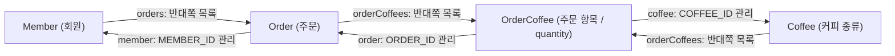

# Spring Data JPA: 4장까지 따라 하며 복습하기

이 저장소는 [Spring Data JPA 학습자료](https://calm-individual-12a.notion.site/Spring-Data-JPA-41bc6b709828800aa8f1dc7adc3767c0)를 공부하며 작성한 예제다. 현재 복습 범위는 **ORM/JPA → 영속성 컨텍스트 → 엔티티 설계 → 단방향·양방향 매핑 → 중간 엔티티를 이용한 다대다 관계**까지다.

목표는 애너테이션을 외우는 데서 끝나지 않고, “지금 어떤 객체가 관리되는가?”, “어떤 필드가 외래 키를 결정하는가?”, “어느 시점에 어떤 SQL이 실행되는가?”를 코드와 DB 결과로 설명하는 것이다. 교안 4장의 일대일 매핑 이후 부분과 5장 Repository 활용은 이번 실습에 포함하지 않는다.

## 1. 처음 실행하기

### 준비와 실행

- 소스 컴파일용 JDK 17이 필요하다. 이 저장소는 Java 17 toolchain을 지정한다. 검증 환경에서는 Gradle 실행에 JDK 21, 소스 컴파일과 예제 실행에 JDK 17을 사용했다.
- 프로젝트에 포함된 Gradle Wrapper를 사용한다. 첫 실행에는 Gradle과 의존성을 내려받을 인터넷 연결이 필요하다.
- 기본 DB는 H2 메모리 DB다. 별도의 PostgreSQL 설치나 DB 생성 없이 실행할 수 있다.
- IntelliJ에서 열었다면 Gradle 프로젝트를 불러오고 Lombok 애너테이션 처리가 활성화되어 있는지 확인한다.

프로젝트 최상위 디렉터리에서 실행한다. 첫 실습은 다음 명령으로 시작한다.

```bash
./gradlew bootRun --args='--study.lesson=basic --study.example=01'
```

Windows에서는 같은 명령의 `./gradlew`를 `gradlew.bat`로 바꾼다. 터미널에서 실행 권한 오류가 나면 macOS/Linux에서 `chmod +x gradlew` 후 다시 실행한다.

콘솔에서 `[basic]`, `[01]` 표시와 SQL 로그를 확인한다. 웹 서버가 함께 실행되므로 예제 출력이 끝나도 프로세스는 대기한다. **다음 예제를 실행하기 전에 Ctrl+C로 종료**한다. 서버 없이 콘솔 실습만 실행하고 바로 종료하려면 다음 인자를 추가한다.

```bash
./gradlew bootRun --args='--study.lesson=basic --study.example=01 --spring.main.web-application-type=none'
```

인자를 전혀 지정하지 않은 `./gradlew bootRun`은 현재 마지막 진도인 `relations / many-to-many`를 실행한다. 각 단원의 기본 예제는 `basic=01`, `mapping=identity`, `relations=many-to-many`다. 처음 복습할 때는 아래 순서대로 두 인자를 모두 명시하자.

### 실행할 때 내부에서 일어나는 순서

1. `CodeitSpringJpaExampleApplication.main()`이 스프링을 시작한다.
2. `application.yml`과 선택한 프로필 설정을 읽고, DB 연결과 엔티티 매핑을 준비한다.
3. `study.lesson`에 해당하는 설정 클래스 하나만 활성화한다.
4. 그 클래스의 `CommandLineRunner`가 `study.example`에 해당하는 메서드 하나를 실행한다.
5. 예제는 EntityManager 생성 → 트랜잭션 시작 → 저장/조회/수정 → 커밋 → 필요시 clear와 재조회 → EntityManager 닫기 순으로 진행한다. 실패하면 남아 있는 트랜잭션을 롤백한다.

`study.lesson`과 `study.example`은 실행할 학습 코드를 고르는 설정값이다. JPA 매핑 문법은 아니므로 처음에는 Runner의 선택 부분을 그대로 두고 실제 예제 메서드에 집중하면 된다. 애너테이션 주석을 해제하거나 여러 Runner를 동시에 켤 필요가 없다.

### DB에서 직접 확인하기

일반 웹 실행 상태에서 [H2 콘솔](http://localhost:8080/h2)에 접속한다.

| 항목 | 값 |
| --- | --- |
| JDBC URL | `jdbc:h2:mem:test` |
| User Name | `sa` |
| Password | 빈칸 |

콘솔의 URL을 기본 표시값 대신 위 값으로 맞춘다. `MEMBER`는 기초 예제, `MEMBERS`는 엔티티 설계·주문 예제의 회원 테이블이다. 기본 매핑에서는 `ORDERS`, `COFFEE`, `ORDER_COFFEE`도 생성된다. 기본/컬럼 예제만 실행해도 사용하지 않은 엔티티의 빈 테이블이 보이는 것은 정상이다.

```sql
SELECT * FROM MEMBER;
SELECT * FROM MEMBERS;
SELECT * FROM ORDERS;
SELECT * FROM COFFEE;
SELECT * FROM ORDER_COFFEE;
```

`ddl-auto: create`는 시작할 때 기존 테이블을 다시 만든다. H2는 종료할 때 데이터도 사라지므로 **예제 하나를 실행하고 관찰한 뒤 종료하는 방식**으로 진행한다. `application-dev.yml`의 PostgreSQL도 `create` 설정이므로 기존 데이터가 있는 DB에 연결하지 말고 별도의 학습용 DB를 사용한다.

## 2. 파일을 읽는 순서

아래 경로는 `src/main/java/com/codeit/codeitspringjpaexample/` 아래를 기준으로 한다. 같은 이름의 `Member`가 두 개 있으므로 import까지 확인한다.

| 순서 | 파일 | 먼저 찾을 부분 |
| --- | --- | --- |
| 0 | `CodeitSpringJpaExampleApplication.java` | `main`과 시작 과정 |
| 1 | `basic/entity/Member.java` | 가장 작은 엔티티, ID, email |
| 2 | `basic/JpaBasicConfig.java` | `example01`부터 `example06`까지 |
| 3 | `member/entity/Member.java` | 컬럼, IDENTITY, `@Transient`; 관계 목록은 잠시 뒤에 읽기 |
| 4 | `member/direct/JpaIdMappingConfig.java` | 식별자와 컬럼별 실험 |
| 5 | `coffee/entity/Coffee.java`, `order/entity/Order.java` | 엔티티 필드와 enum; 관계 필드는 4단계에서 다시 읽기 |
| 6 | `Order.member` → `Member.orders` | 주인과 반대쪽 탐색 |
| 7 | `order/entity/OrderCoffee.java` → `Order.orderCoffees` → `Coffee.orderCoffees` | 두 외래 키, 수량, 양방향 연결 |
| 8 | `order/test/OrderTestRunner.java` | enum부터 다대다까지 실행 흐름 |

`member/dto/MemberPostDto.java`는 일반 요청 객체의 흔적이다. `member/controller`, `member/service`, `member/repository`의 파일은 기존 코드를 주석 상태로 보존한 것으로, 현재 실행에는 참여하지 않는다. 현재 엔티티의 필수값·이름과 맞지 않는 과거 코드도 있으므로 이번 복습에서는 주석을 해제하지 않는다.

## 3. 단계 1 — ORM과 영속성 컨텍스트

### 먼저 이해할 개념

- **ORM**: 자바 객체와 관계형 DB의 테이블을 매핑해 객체의 저장·조회를 SQL과 연결하는 방식이다.
- **JPA**: ORM을 사용하기 위한 자바 표준 API다. 이 프로젝트에서는 Hibernate가 실제 매핑과 SQL 처리를 수행한다.
- **EntityManagerFactory**: EntityManager를 만드는 출발점이다. 스프링이 준비한 Factory를 주입받아 사용한다.
- **EntityManager / 영속성 컨텍스트**: 엔티티를 관리하고 식별자에 따라 조회하며 변경을 추적한다. 1차 캐시는 이 관리 범위에 속한다.
- **트랜잭션**: 변경을 확정하거나 취소하는 단위다. `persist`와 `commit`은 별개의 동작이다.

### 따라 작성하는 순서

1. `basic/entity/Member`에서 `@Entity`, `@Id`, `@GeneratedValue`, `email`, 기본 생성자를 살펴본다. `new Member(...)`가 DB 저장 명령은 아니라는 점을 먼저 설명해 본다.
2. `JpaBasicConfig`에서 `example01()`의 본문을 기준으로 `tx.begin()` → 객체 생성 → `persist()` → `find()` → `commit()` 순서로 따라 작성한다.
3. 실행 전에 출력값과 SQL이 나올 위치를 예상한다. 실행 후 예상과 비교한다.
4. 아래 표 순서로 `study.example`만 바꿔 각각 다시 실행한다. 앞 예제의 데이터가 남아 있어야 하는 구조가 아니며 각 예제가 자기 데이터를 준비한다.

| 예제 | 관찰할 동작 | 기대 결과 / 확인할 SQL |
| --- | --- | --- |
| `01` | 비영속 → 영속, 1차 캐시 | 관리 여부 `false → true`, `member == found`는 `true` |
| `02` | commit 후 clear, DB 조회 후 캐시 조회 | 두 find는 같은 객체, clear 이전 객체와는 다른 객체; 첫 find의 SELECT 확인 |
| `03` | 두 객체 persist → flush → commit | INSERT 위치 비교; flush 후에도 트랜잭션 활성 상태 `true` |
| `04` | 조회한 객체의 email 변경 | 별도 update 호출 없이 UPDATE, DB 재조회는 `vanilla@cat.cat` |
| `05` | 조회한 객체 remove | DELETE, clear 후 find 결과 `null` |
| `06` | clear로 준영속 상태가 된 객체 수정 | 관리 여부 `false`, 객체는 `detached@cat.cat`, DB는 `original@cat.cat` |

예를 들어 변경 감지는 다음 명령으로 확인한다.

```bash
./gradlew bootRun --args='--study.lesson=basic --study.example=04'
```

`@GeneratedValue`의 기본 전략은 AUTO이며 실제 ID 생성 방식은 구현체와 DB가 결정한다. ID 확보용 SQL이 먼저 보일 수 있다. 다음 단계의 IDENTITY에서는 ID를 받으려고 `persist` 시 INSERT가 실행될 수도 있다. **“persist는 항상 SQL을 실행하지 않는다”라고 일반화하지 않는다.**

`flush()`는 관리 중인 변경을 DB에 동기화하는 동작이고 `commit()`은 트랜잭션을 확정하는 동작이다. `clear()`는 객체를 관리 대상에서 분리하며 DB 데이터를 지우지 않는다. commit도 그 자체로 모든 객체를 준영속 상태로 바꾸는 명령은 아니다.

### 스스로 설명해 보기

- 같은 ID를 두 번 `find`했을 때 같은 객체가 반환되는 조건은 무엇인가?
- SQL 로그에 INSERT가 나왔다는 사실만으로 트랜잭션이 커밋됐다고 할 수 있는가?
- `clear` 뒤 객체의 email만 수정했을 때 DB가 바뀌지 않는 이유는 무엇인가?

## 4. 단계 2 — 엔티티와 컬럼 설계

이번에는 **`member/entity/Member`**를 사용한다. 기초용 `basic/entity/Member`와 섞지 않는다.

### 따라 작성하는 순서

1. `memberId`와 `@GeneratedValue(strategy = IDENTITY)`를 확인한다. ID는 생성자에 직접 넣지 않는다.
2. `email`, `name`, `phone`의 `@Column` 설정을 읽고 정상 저장에 필요한 값을 만든다. `new Member()`만 영속화하면 필수값이 빠진다.
3. 생성자에서 email/name/phone을 초기화하고, `JpaIdMappingConfig`의 `identity()`를 따라 쓴다.
4. 아래 표 순서로 필드 하나씩 관찰한다. 예제마다 commit 후 clear와 재조회를 하는 이유도 확인한다.
5. `Coffee`의 가격/이름/코드와 `Order`의 날짜/상태 필드를 같은 방식으로 읽는다.

| 예제 | 설정의 의미 | 기대 결과 |
| --- | --- | --- |
| `identity` | DB가 기본 키 생성 | persist 전 ID `null`, 저장 후 생성된 ID로 재조회 |
| `column` | 일반 컬럼과 변경 감지 | name을 바꾸면 DB 재조회 결과 `변경 후` |
| `transient` | `@Transient` 필드는 저장 제외 | 같은 객체의 age는 `20`, clear 후 재조회 객체의 age는 `null` |
| `updatable` | email을 UPDATE 대상에서 제외 | 객체 email은 `changed@cat.cat`, DB email은 `original@cat.cat`; name은 변경됨 |
| `unique` | 이메일 중복 금지 | 의도한 제약 위반 로그와 `[unique] 예상한 제약 위반` 표시 |
| `nullable` | name의 null 금지 | 의도한 제약 위반 로그와 `[nullable] 예상한 제약 위반` 표시 |

```bash
./gradlew bootRun --args='--study.lesson=mapping --study.example=identity'
./gradlew bootRun --args='--study.lesson=mapping --study.example=updatable'
```

위 명령은 각각 따로 실행한다. `unique`, `nullable`은 **실패 원인을 관찰하는 예제**다. 예상된 저장 예외를 처리한 다음 롤백하므로 이 실습의 행은 남지 않는다. 오류가 persist 시점에 나타날 수도 있고 flush 시점에 나타날 수도 있다. 마지막의 예상 제약 위반 표시와 그 위의 실제 원인을 함께 읽는다.

주의해서 구분할 내용은 다음과 같다.

- `@Entity(name = "MEMBERS")`는 JPA 엔티티 이름을 지정한다. DB 테이블 이름을 별도로 지정하는 애너테이션은 `@Table`이다. 현재는 별도 테이블명을 지정하지 않아 기본 매핑으로 `MEMBERS`를 사용한다.
- `nullable`, `unique`, `length`는 컬럼 매핑 정보다. setter 호출 시 입력을 검사해 주는 기능이 아니다. `length`는 문자열 컬럼 길이를 정하며 숫자 필드의 값 범위를 정하지 않는다.
- `updatable=false`는 setter를 막지 않는다. 객체 값과 DB 값이 다를 수 있으므로 clear 후 재조회로 비교한다.
- `@Transient`와 자바의 `transient` 키워드를 혼동하지 않는다. 여기서는 JPA 매핑 제외를 관찰한다.
- `createdAt`, `modifiedAt`은 현재 객체 생성 시 초기값만 들어간다. 수정 시간을 자동으로 바꾸는 기능은 없으며 `column` 예제에서는 직접 수정한다.
- Lombok의 `@Getter`, `@Setter`, `@NoArgsConstructor`는 자바 메서드/생성자를 만드는 도구다. DB 매핑을 지정하지 않는다.

`OrderStatus`의 enum은 다음 단계 첫 예제에서 관찰한다. `EnumType.STRING`은 `ORDER_REQUEST` 같은 **상수 이름**을 저장한다. `stepNumber`나 한국어 설명을 저장하는 설정이 아니다.

## 5. 단계 3 — 단방향에서 양방향으로

### 테이블과 객체 관계를 먼저 그리기

테이블은 외래 키로 연결되고, 객체는 필드의 참조로 연결된다. 객체에서 어느 쪽으로 탐색할 것인지와 외래 키를 어느 쪽이 쓰는지를 구별한다.



| 관계 | 외래 키가 있는 테이블 | 주인 필드 | 반대쪽 필드와 mappedBy |
| --- | --- | --- | --- |
| 회원 1 : 주문 N | `ORDERS.MEMBER_ID` | `Order.member` | `Member.orders`, `mappedBy="member"` |
| 주문 1 : 주문 항목 N | `ORDER_COFFEE.ORDER_ID` | `OrderCoffee.order` | `Order.orderCoffees`, `mappedBy="order"` |
| 커피 1 : 주문 항목 N | `ORDER_COFFEE.COFFEE_ID` | `OrderCoffee.coffee` | `Coffee.orderCoffees`, `mappedBy="coffee"` |

`mappedBy`에는 DB 컬럼명이나 클래스명이 아닌 **상대 엔티티의 자바 필드명**을 쓴다. 이 목록에만 객체를 추가해서는 외래 키가 갱신되지 않는다. “연관관계의 주인”은 외래 키를 관리하는 필드를 뜻하며, 업무에서 더 중요한 객체라는 뜻이 아니다.

### 따라 작성하는 순서

1. `Order`의 `member` 필드에 `@ManyToOne`, `@JoinColumn(name="MEMBER_ID")`가 있는 이유를 읽는다. 이것이 주문 → 회원 단방향 매핑의 핵심이다.
2. 회원을 먼저 persist하고, 주문의 `member`를 설정한 다음 주문을 persist하는 흐름을 따라 쓴다.
3. 반대쪽 탐색이 필요할 때 `Member.orders`와 `@OneToMany(mappedBy="member")`를 추가하는 순서를 이해한다. 현재 저장소는 여기까지 완성된 상태다.
4. `member.addOrder(order)`와 `order.addMember(member)`가 두 객체의 참조를 어떻게 맞추는지 한 줄씩 추적한다. 서로 부르더라도 조건 검사로 재호출이 멈추는 지점을 찾는다.
5. 마지막으로 `owner` 예제에서 반대쪽만 변경했을 때와 주인까지 변경했을 때를 비교한다.

```bash
./gradlew bootRun --args='--study.lesson=relations --study.example=many-to-one'
```

| 실행 순서 | 예제 | 확인할 결과 |
| --- | --- | --- |
| 1 | `enum` | 재조회 상태 `ORDER_REQUEST`; DB의 `ORDER_STATUS`도 상수 이름 |
| 2 | `many-to-one` | setter 직후 회원.orders는 `0`, DB 재조회 주문 → 회원은 `luckyKim`, 재조회 회원.orders는 `1` |
| 3 | `one-to-many` | 편의 메서드로 양쪽 연결; clear 이전과 이후 모두 주문 목록 크기 `1` |
| 4 | `owner` | 목록만 변경하면 재조회 order.member는 `null`, 회원.orders는 `0`; 편의 메서드로 고친 뒤 회원 이름과 목록 크기 `1` 확인 |

`many-to-one` 예제는 **완성된 양방향 엔티티에서 한 방향만 사용**하는 실습이다. 현재 `Member.orders` 매핑도 있으므로 구조 자체가 단방향인 것은 아니다. 단방향부터 새로 따라 작성할 때는 주문의 member 참조까지만 만든 뒤 반대쪽 목록과 편의 메서드를 추가하는 순서로 진행한다. 이 저장소에서 실행만 복습할 때는 관계 필드를 지울 필요가 없다.

일반 setter는 반대쪽 목록까지 자동으로 맞추지 않는다. 편의 메서드는 객체 양쪽의 상태를 맞추지만, **그 자체로 persist나 commit을 실행하지 않는다.** 이 둘을 구분해야 “메모리에서는 보이는데 DB에는 안 남는” 상황을 설명할 수 있다.

## 6. 단계 4 — 다대다 관계를 중간 엔티티로 풀기

한 주문에는 여러 커피가 들어가고 같은 커피는 여러 주문에 들어갈 수 있다. 이 연결에는 주문별 수량도 필요하다. 현재 예제는 교안처럼 `OrderCoffee`를 두어 두 개의 다대일 관계로 표현한다.

```text
Order 1 ── N OrderCoffee N ── 1 Coffee
               quantity
```

여기서 양방향은 `Order ↔ OrderCoffee`와 `Coffee ↔ OrderCoffee` 양쪽에서 탐색할 수 있다는 뜻이다. `@ManyToMany`로 두 엔티티를 직접 연결하는 예제는 추가하지 않는다.

### 따라 작성하는 순서

1. `OrderCoffee`의 자체 식별자와 `order`, `coffee`, `quantity` 필드를 읽는다. 수량이 Coffee가 아닌 주문 항목에 있어야 하는 이유를 생각한다.
2. `order`, `coffee`에 각각 `@ManyToOne`과 `@JoinColumn`으로 외래 키를 매핑한다.
3. `Order.orderCoffees`와 `Coffee.orderCoffees`에 역방향 목록과 정확한 `mappedBy` 필드명을 지정한다.
4. `addOrder`/`addCoffee`로 양쪽 참조를 맞춘다. 같은 항목이 중복으로 들어가지 않는 조건도 확인한다.
5. Runner의 `mappingManyToManyTest()`를 다음 순서로 따라 작성한다: 회원·커피 두 종류 저장 → 주문과 회원 연결·주문 저장 → 주문 항목 두 개 생성 → 주문·커피 연결·수량 설정 → 항목 각각 저장 → commit → clear → 재조회.

```bash
./gradlew bootRun --args='--study.lesson=relations --study.example=many-to-many'
```

확인할 결과는 다음과 같다. ID의 구체적인 숫자와 목록의 출력 순서는 고정하지 않는다.

```text
[다대다] 주문한 회원 = luckyKim
[다대다] 주문항목 개수 = 2
[다대다] 아메리카노 / 2잔
[다대다] 카페 라테 / 1잔
[다대다] 아메리카노 → 주문항목 개수 = 1
[다대다] 커피 → 주문항목 → 주문 ID = (생성된 주문 ID)
```

DB에서는 `ORDER_COFFEE`의 두 행에 `ORDER_ID`, `COFFEE_ID`, `QUANTITY`가 올바르게 들어갔는지 확인한다. 부모 객체를 참조하는 것만으로 저장이 끝나는 것이 아니므로, 이 실습에서는 참조할 엔티티를 먼저 저장하고 주문 항목도 각각 명시적으로 persist한다.

### 같은 범위에서 해 보는 복습 과제

- 같은 아메리카노를 3잔 담은 두 번째 주문과 주문 항목을 추가한다. 기존 커피 객체를 재사용하고, commit → clear 후 아메리카노의 주문 항목 수가 `2`인지 확인한다. 이것이 “여러 주문이 같은 커피를 참조함”을 보여 준다.
- 기존 주문 항목의 수량을 바꾸고 commit → clear 후 변경 감지로 반영됐는지 확인한다.
- 같은 `addOrderCoffee`를 두 번 호출한 뒤 목록에 항목이 한 번만 들어 있는지 확인한다.
- 이미 연결된 주문의 회원을 다른 회원으로 바꾸고, 이전·새 회원의 목록과 DB의 MEMBER_ID를 함께 확인한다.

## 7. SQL과 결과를 읽는 방법

예제마다 **출력 예상 → 실행 → SQL 관찰 → clear 후 재조회 → 자기 말로 설명** 순서로 복습한다.

1. `persist` 앞뒤에서 INSERT나 ID 생성 SQL이 언제 나오는지 확인한다.
2. `find`가 실행될 때 SELECT 유무를 확인한다. 이미 관리 중인 동일 ID 객체라면 캐시에서 가져올 수 있다.
3. 필드를 수정한 뒤 commit/flush에서 UPDATE가 생기는지 확인한다. `updatable=false` 필드가 SQL에서 제외되는지도 본다.
4. 관계를 연결할 때 INSERT/UPDATE에 어떤 외래 키 값이 반영되는지 확인한다.
5. 관계 조회 과정에서 SELECT가 추가로 보일 수 있다. 현재 단계에서는 성능 개선으로 확장하지 않고 외래 키와 객체 탐색 결과를 확인하는 데 집중한다.

같은 객체를 출력하는 것만으로 DB 저장 여부를 판단하지 않는다. 예제의 `commit → clear → find`는 메모리에 남은 참조와 실제 DB 저장 결과를 구별하기 위한 흐름이다.

## 8. 자주 막히는 지점

| 현상 | 확인할 곳 |
| --- | --- |
| JDK 17 toolchain을 찾을 수 없음 | JDK 17 설치와 IDE의 Gradle/JDK 설정 확인, `java -version`, `./gradlew -version` 확인 |
| 한글 출력이 `?`로 표시됨 | Gradle 실행은 UTF-8로 설정되어 있다. IDE main 직접 실행이나 JAR 직접 실행 시 VM 옵션 `-Dfile.encoding=UTF-8` 지정 |
| PostgreSQL 연결 오류 | 기본은 local이다. IDE 실행 인자나 `SPRING_PROFILES_ACTIVE`가 dev를 지정했는지 확인 |
| `8080` 포트 사용 중 | 직전 실행을 Ctrl+C 또는 IDE Stop으로 종료 |
| 예제 값 오류 | basic/mapping/relations 각각의 예제 이름을 표에서 확인; 다른 단원의 예제명을 재사용하지 않기 |
| 예상과 다른 Member 필드/생성자 | import가 basic용인지 member용인지 확인 |
| 저장되지 않은 객체 참조 관련 오류 | 참조할 회원·주문·커피를 먼저 저장했는지 확인 |
| name/phone의 null 제약 위반 | 현재 Member 생성자에 필수값을 모두 넣었는지 확인 |
| email/phone 중복 오류 | 같은 실행 안에서 만든 회원들의 중복값 확인; unique 실습에서는 의도된 결과 |
| 회원 목록은 있는데 재조회하면 비어 있음 | `Order.member`를 설정했는지 확인; owner 예제와 비교 |
| `find`가 null이거나 기대한 행을 못 찾음 | `1L`을 가정하지 않고 저장한 객체의 실제 ID로 조회했는지 확인 |
| H2 콘솔에 데이터가 안 보임 | 실행 중인지, JDBC URL이 `jdbc:h2:mem:test`인지, 해당 예제를 실행했는지 확인 |
| 예제가 끝났는데 서버가 계속 실행됨 | 정상이다. H2 관찰 후 종료하거나 콘솔 전용 실행 인자를 사용 |

## 9. 자동 검증과 복습 완료 기준

```bash
./gradlew test
```

테스트는 `local` H2 환경에서 시작 실습을 끄고(`study.lesson=none`) 실행한다.

- `CodeitSpringJpaExampleApplicationTests`: 스프링과 엔티티 매핑이 정상으로 시작되는지 확인한다.
- `order/AssociationMappingTests`: 두 주문이 같은 커피를 참조하는 저장 결과와 수량, 관계의 주인, 편의 메서드의 중복 방지와 관계 변경을 실제 재조회로 검증한다.

테스트 파일은 실습 보강용이다. 처음에는 Runner를 직접 따라 작성해 관찰하고, 그 결과를 자동으로 확인하는 방법으로 읽으면 된다.

다음을 설명하고 코드로 재현할 수 있으면 현재 진도의 복습을 마친 것이다.

- new/persist/clear/remove의 차이와 영속·비영속·준영속·삭제 상태를 설명한다.
- 같은 컨텍스트에서의 ID 조회와 1차 캐시, 변경 감지, 쓰기 지연을 SQL과 연결한다.
- flush와 commit을 구분하고 직접 생성한 EntityManager의 종료와 실패 시 rollback을 놓치지 않는다.
- 식별자와 컬럼 매핑을 설계하고 객체 값과 DB 값이 다를 수 있는 예를 재현한다.
- 단방향 참조에서 반대쪽 목록을 추가해 양방향으로 확장하는 순서를 설명한다.
- 세 관계의 주인과 외래 키 위치, mappedBy의 필드명을 정확히 짚는다.
- 주문·커피의 다대다 관계를 OrderCoffee로 풀고 주문별 수량을 저장한 뒤 양쪽에서 탐색한다.

공식 설명을 다시 확인할 때는 [Jakarta Persistence 명세](https://jakarta.ee/specifications/persistence/3.2/jakarta-persistence-spec-3.2)와 [Hibernate의 flush 설명](https://docs.hibernate.org/orm/current/userguide/html_single/#flushing)을 참고한다. 이번에는 위 완료 기준까지 익히고, 이후 내용은 수업 진도에 맞춰 진행한다.
